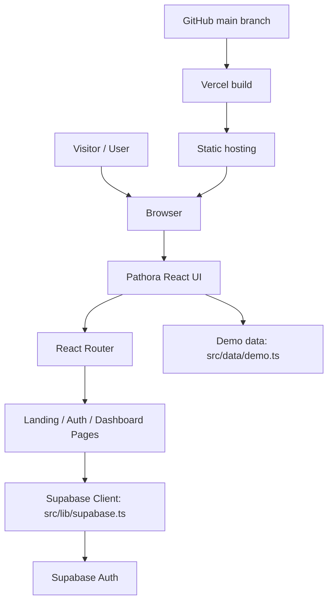
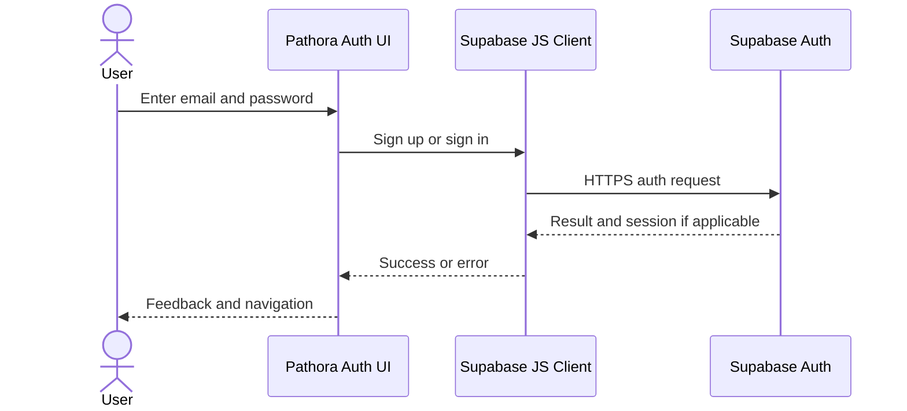

# Pathora — Technical Design Document
**Version:** 1.0  
**Status:** Initial design based on the known repository structure  
**Tagline:** Turning Skills Into Opportunities

> Update this document whenever the implementation changes. This document does not claim that backend tables or APIs exist unless implemented.

## 1. Purpose
Pathora is a React-based web application intended to help users explore skills and career opportunities. The frontend uses React, TypeScript and Vite. Supabase is used for authentication, and Vercel hosts the static production build.

## 2. Technology stack

| Layer | Technology | Responsibility |
|---|---|---|
| UI | React 18 + TypeScript | Components and client interaction |
| Build | Vite | Development server and production bundle |
| Routing | React Router | Client-side navigation |
| Styling | Tailwind CSS and global CSS | Responsive layout and theme |
| Charts | Recharts | Charts where used |
| Icons | Lucide React | Interface icons |
| Authentication | Supabase JS client | Email/password auth and session |
| Hosting | Vercel | Static hosting and deployment |
| Source control | GitHub | Source history and deployment source |

## 3. Architecture diagram

## 4. Authentication sequence

## 5. Deployment and configuration
- Repository: https://github.com/Devakawale/Pathora
- Host: Vercel
- Build command: `npm run build`
- Output directory: `dist`
- Required environment variables: `VITE_SUPABASE_URL`, `VITE_SUPABASE_PUBLISHABLE_KEY`

Configure environment variables in local `.env.local` and in Vercel settings separately. Do not commit `.env.local`.

## 6. Main code areas

| Path | Responsibility |
|---|---|
| `src/App.tsx` | App composition and routing |
| `src/main.tsx` | Frontend entry point |
| `src/components/Layout.tsx` | Shared layout |
| `src/components/Brand.tsx` | Brand UI |
| `src/components/Charts.tsx` | Chart components |
| `src/config/brand.ts` | Brand/theme configuration |
| `src/data/demo.ts` | Demo data |
| `src/lib/supabase.ts` | Supabase client configuration |
| `src/pages/Landing.tsx` | Landing page |
| `src/pages/Auth.tsx` | Authentication UI |
| `src/pages/Dashboard.tsx` | Dashboard UI |
| `src/styles.css` | Global styling |

## 7. Security
1. Never expose Supabase `service_role` keys or database passwords in browser code.
2. `VITE_` values are client-side values, not secrets. Use only the intended publishable/anon key.
3. Enable Row Level Security (RLS) for any user-specific Supabase tables and create appropriate policies before client-side data access.
4. Authorize sensitive operations in the backend/database, not only in UI logic.
5. Use HTTPS and configure allowed redirect URLs carefully.
6. Never log passwords or access tokens.
7. Keep dependencies updated and review changes before merging.

## 8. Reliability and performance
- Run `npm run build` before deployment.
- Check browser console and network requests when debugging.
- Test navigation and authentication on desktop and mobile.
- Verify the production URL after each release.

## 9. Current boundaries / follow-up
- A production database schema or business API was not confirmed from the available project inventory.
- The test cases provided are manual, not automated.
- Google OAuth should only be offered after it is configured and tested.
- Document database tables, RLS policies, APIs and automated test infrastructure if they are added.
